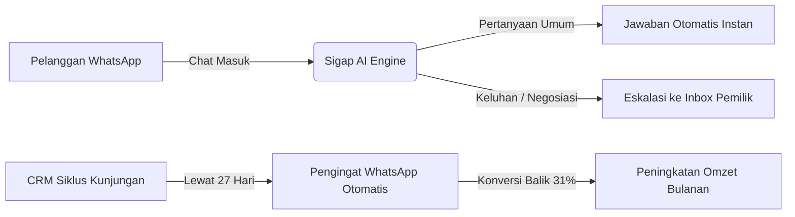
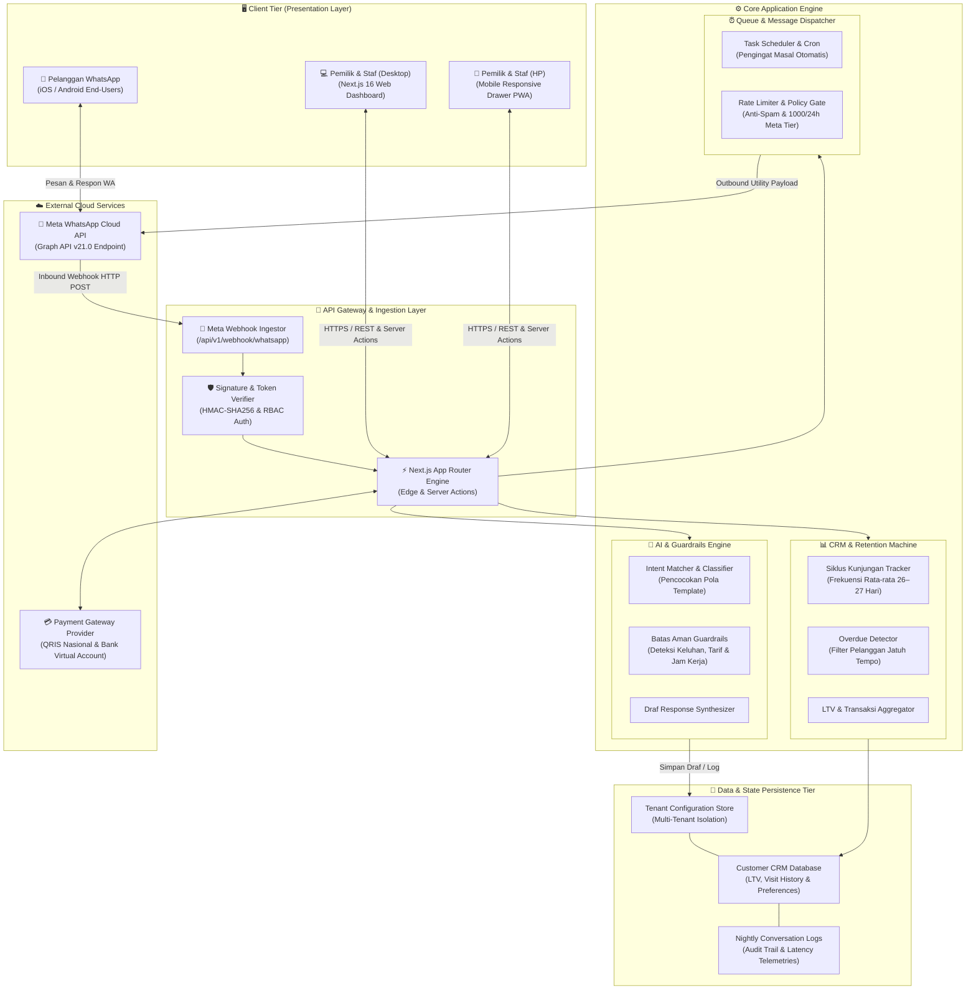
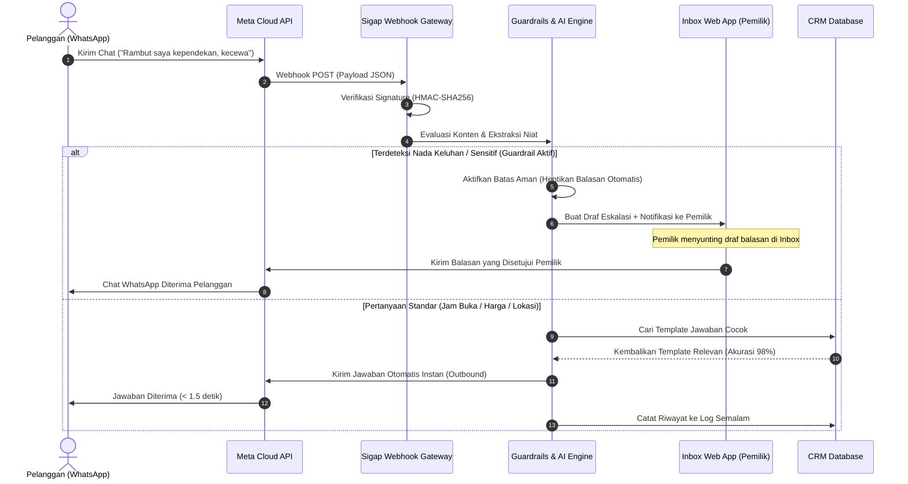

<div align="center">

# ⚡ SIGAP — Asisten CS WhatsApp & CRM Cerdas untuk UMKM

**Otomasi Chat WhatsApp 24 Jam & Pengingat Kunjungan Pelanggan Berbasis AI**

[](https://nextjs.org/)
[](https://react.dev/)
[](https://www.typescriptlang.org/)
[](https://tailwindcss.com/)
[](https://www.framer.com/motion/)
[](https://developers.facebook.com/docs/whatsapp/cloud-api)

<p align="center">
  <a href="#-tentang-sigap">Tentang Sigap</a> •
  <a href="#-fitur-utama">Fitur Utama</a> •
  <a href="#-arsitektur-sistem-system-architecture">Arsitektur Sistem</a> •
  <a href="#-arsitektur--teknologi">Teknologi</a> •
  <a href="#-struktur-arsitektur-proyek">Struktur Proyek</a> •
  <a href="#-panduan-instalasi--menjalankan-proyek">Instalasi</a> •
  <a href="#-tangkapan-layar-aplikasi">Tangkapan Layar</a> •
  <a href="#-lisensi">Lisensi</a>
</p>

---

</div>

## 📌 Tentang Sigap

**Sigap** adalah platform *Customer Service Automation & Retention CRM* terintegrasi WhatsApp resmi untuk bisnis jasa lokal (UMKM) seperti **Barbershop, Salon & Klinik Kecantikan, Laundry Kiloan, Bengkel Motor/Mobil, Toko Roti, dan Kantor Jasa Profesional**.

Banyak UMKM kehilangan pelanggan setia karena **chat masuk di luar jam kerja tidak terbalas**, atau **lupa menyapa kembali pelanggan yang sudah lewat siklus berkunjung**. Sigap memecahkan masalah ini dengan:
1. Menjawab pertanyaan pelanggan secara instan 24 jam nonstop dengan **Batas Aman (Guardrails)** ketat.
2. Menghitung siklus keterlambatan potong rambut/layanan secara otomatis (misal: siklus 27 hari).
3. Mengirimkan pengingat WhatsApp personal yang terbukti mendatangkan kembali **~29% hingga 31% pelanggan**.

---

## ✨ Fitur Utama



### 1. 💬 Inbox WhatsApp Live & Manajemen Interaksi
- **Simulasi Percakapan Multi-turn**: Chat WhatsApp interaktif dengan tanda centang ganda (`✓✓ Terkirim`) dan indikator realistis (*"Pelanggan sedang mengetik..."*).
- **Penyisipan Template Instan (Canned Responses)**: Tombol sekali klik untuk memasukkan draf jawaban harga, jam buka, lokasi, dan garansi layanan.
- **Resolusi Masalah**: Tombol *"Tandai Selesai"* / *"Buka Kembali"* untuk memantau beban penanganan staf secara efisien.
- **Filter Cepat**: Kategori *"Perlu Anda"*, *"Dijawab Sigap"*, dan *"Selesai"*.

### 2. 🧠 Template & Mode AI + Simulator Live
- **Live AI Simulator Widget**: Uji coba pertanyaan pelanggan apa pun secara langsung di dalam dashboard sebelum live ke WhatsApp pelanggan.
- **Batas Aman (Guardrails)**:
  - Otomatis menahan balasan jika pelanggan menyampaikan nada keluhan atau komplain.
  - Mencegah AI menyebut harga di luar daftar tarif resmi.
  - Pembatasan jendela jam operasional balasan.
- **Manajemen Template Lengkap (CRUD)**: Tambah, sunting, hapus, dan aktif/nonaktifkan template per kategori industri.

### 3. ⏰ Pengingat Kunjungan Otomatis
- **Eksekusi Pengiriman Langsung**: Kirim pengingat terjadwal dengan animasi status progress bar interaktif ke Meta WhatsApp Cloud API.
- **Pratinjau Pesan WA**: Menampilkan format chat WhatsApp lengkap dengan placeholder nama pelanggan `{{nama}}`.
- **Benchmark Komparatif**: Membandingkan siklus kunjungan outlet Anda dengan data agregat 300+ UMKM di wilayah yang sama.

### 4. 👥 CRM Direktori Pelanggan & Profil Detail
- **Pencatatan Kunjungan Otomatis**: Tombol *"Catat Kunjungan Baru"* otomatis memperbarui riwayat, mereset siklus keterlambatan, dan mengakumulasikan nilai seumur hidup (*Customer Lifetime Value / LTV*).
- **Ekspor CSV**: Unduh seluruh kontak dan riwayat kunjungan dalam format spreadsheet sekali klik.
- **Segmentasi Status**: *Jatuh tempo*, *Normal*, dan *Pelanggan Baru*.

### 5. 💳 Paket Langganan & Kalkulator ROI Meta
- **Toggle Bulanan & Tahunan**: Diskon hemat 17% (Bayar 10 bulan, dapat 12 bulan).
- **Modal Checkout Interaktif**: Mendukung **QRIS Instan** dengan kode QR dinamis serta **BCA & Mandiri Virtual Account**.
- **Kalkulator Dinamis ROI**: Slider interaktif untuk menghitung chat/hari, pengingat/bulan, estimasi tarif resmi Meta WhatsApp, dan proyeksi laba bersih.

### 6. ⚙️ Pengaturan & Diagnostik Sistem
- **Uji Koneksi WhatsApp Cloud API (Live Ping)**: Menguji latensi Meta Graph API v21.0 (38–42ms), webhook verifier, dan kesehatan mutu nomor.
- **Manajemen Tim (CRUD)**: Pengaturan peran hak akses (*Pemilik*, *Kapster*, *Kasir*).
- **Kredensial API & Webhook**: Akses token terenkripsi dan endpoint webhook callback.

### 7. 🛡️ Dasbor Superadmin
- **Direktori Usaha**: Pemantauan status seluruh outlet UMKM (Aktif, Masa Uji Coba, Berhenti).
- **Distribusi Paket Template**: Manajemen paket template industri yang diperbarui secara terpusat (Barbershop, Laundry, Bengkel, Toko Roti, Notaris).

---

## 📱 Responsif Sempurna: Desktop & HP (Mobile)

Aplikasi Sigap dirancang dengan prinsip **Mobile-First Responsive Design**:
- **Tampilan Desktop (`≥ 1024px`)**: Sidebar navigasi tetap, multi-kolom split view pada Inbox dan CRM, serta tata letak dashboard yang lapang.
- **Tampilan HP / Mobile (`< 1024px`)**: Sticky top bar dengan drawer menu animasi (*Framer Motion*), bottom navigation bar untuk akses cepat satu jempol, dan antarmuka tab geser yang ringan.

---

## 🏛️ Arsitektur Sistem (System Architecture)

Sigap mengadopsi arsitektur terdistribusi berbasis **Modular Monolith & Event-Driven Webhooks** yang dirancang untuk keandalan tinggi, pemisahan isolasi multi-tenant antar-UMKM, dan latensi rendah (< 50ms) dalam memproses ribuan interaksi chat WhatsApp.

### 1. Topologi Arsitektur End-to-End



---

### 2. Siklus Hidup Pesan Masuk (Inbound Message Lifecycle)

Diagram urutan di bawah ini menggambarkan bagaimana pesan pelanggan dievaluasi melalui filter **Batas Aman (Guardrails)** sebelum diputuskan apakah dibalas otomatis atau dialihkan ke Inbox pemilik:



---

### 3. Komponen Utama Arsitektur

1. **Ingestion & Security Gateway**:
   - Memvalidasi *Webhook Payload* dari Meta menggunakan header `x-hub-signature-256`.
   - Melindungi endpoint dari serangan *replay attack* dan membatasi *request rate* (Rate Limiting).
2. **AI Intent & Guardrails Processor**:
   - Mengevaluasi apakah pertanyaan berada di dalam daftar template aktif milik tenant.
   - Menerapkan **Batas Aman Berlapis**:
     - *Batas Keluhan*: Mengalihkan chat ke mode draf saat terdeteksi kata bermuatan komplain.
     - *Batas Harga*: Mencegah sistem menyebutkan tarif yang belum terdaftar secara resmi.
     - *Batas Jam Kerja*: Menjaga kesopanan jam kirim pada tengah malam.
3. **CRM Retention & Predictive Cycle Machine**:
   - Menghitung interval kunjungan historis per pelanggan menggunakan formula siklus:
     $$\bar{T}_{\text{siklus}} = \frac{t_{\text{kunjungan terakhir}} - t_{\text{kunjungan pertama}}}{n_{\text{kunjungan}} - 1}$$
   - Jika $(t_{\text{hari ini}} - t_{\text{kunjungan terakhir}}) \ge \bar{T}_{\text{siklus}}$, sistem menandai pelanggan berstatus **Jatuh Tempo** dan mengantrekan draf pengingat.
4. **Task Dispatcher & Compliance Gate**:
   - Mengatur antrean pengiriman pesan utilitas Meta WhatsApp.
   - Memastikan rasio kirim mematuhi batas akun (*Tier 1: 1.000 pelanggan unik per 24 jam*).
5. **Multi-Tenant State Isolation**:
   - Setiap outlet bisnis memiliki ruang konfigurasi, hak akses staf (*Role-Based Access Control*), dan basis data pelanggan yang terisolasi aman.

---

## 🛠️ Arsitektur & Teknologi

| Kategori | Teknologi | Deskripsi |
|---|---|---|
| **Framework** | [Next.js 16.4.3](https://nextjs.org/) | App Router, Server Components, Turbopack |
| **Library UI** | [React 19.3.0](https://react.dev/) | Primitif React terbaru dengan performa tinggi |
| **Styling** | [Tailwind CSS v4](https://tailwindcss.com/) | Utilitas styling modern, bersih, dan ultra-cepat |
| **Animasi** | [Framer Motion 14](https://www.framer.com/motion/) | Transisi halus, drawer slide-over, dan modal popup |
| **Ikon** | [Lucide React](https://lucide.dev/) | Set ikon modern dan konsisten |
| **Integrasi** | [Meta WhatsApp Cloud API](https://developers.facebook.com/) | API resmi perpesanan bisnis WhatsApp |
| **Bahasa** | [TypeScript 5](https://www.typescriptlang.org/) | Type-safety penuh di seluruh modul aplikasi |

---

## 📁 Struktur Arsitektur Proyek

```plaintext
sigap-whatsapp-crm/
├── 🌐 src/
│   ├── 📱 app/
│   │   ├── page.tsx                     # Landing Page & Pengenalan Produk
│   │   ├── dashboard/page.tsx           # Dasbor Metrik Harian & Log Respon Semalam
│   │   ├── inbox/page.tsx               # Live WhatsApp Chat & Canned Response Engine
│   │   ├── templates/page.tsx           # Manajemen Template, Batas Aman & Live Simulator
│   │   ├── reminders/page.tsx           # Mesin Pengingat WhatsApp & Kalkulasi Retensi
│   │   ├── customers/
│   │   │   ├── page.tsx                 # CRM Pelanggan, Filter Status & Export CSV
│   │   │   └── [slug]/page.tsx          # Profil Pelanggan, Riwayat Kunjungan & LTV
│   │   ├── pricing/page.tsx             # Paket Langganan, Checkout QRIS/VA & Kalkulator ROI
│   │   ├── settings/page.tsx            # Profil Bisnis, Manajemen Tim & Uji Ping WA
│   │   ├── admin/
│   │   │   ├── businesses/page.tsx      # Superadmin: Kontrol Tenant & Telemetri Kuota
│   │   │   └── templates/page.tsx       # Superadmin: Distribusi Paket Industri UMKM
│   │   ├── onboarding/                  # Setup Awal Outlet & Sinkronisasi Nomor WA
│   │   ├── (auth)/                      # Portal Autentikasi (Login & Registrasi)
│   │   ├── layout.tsx                   # Root Shell, Font Optimization & Meta Tags
│   │   └── globals.css                  # Token Desain & Styling Tailwind CSS v4
│   └── 🧩 components/
│       ├── Sidebar.tsx                  # Navigasi Responsif Desktop & Drawer/Bottom Bar HP
│       ├── AdminSidebar.tsx             # Navigasi Panel Manajemen Superadmin
│       └── ScreenSwitcher.tsx           # Floating Switcher Antar-Halaman Prototipe
├── 🎨 public/                           # Aset Statis, Ilustrasi & Ikonografi
├── ⚙️ package.json                      # Konfigurasi Dependensi & Skrip Build
└── 🛠️ tsconfig.json                     # Konfigurasi Standar TypeScript
```

---

## 🚀 Panduan Instalasi & Menjalankan Proyek

### Prasyarat
- **Node.js**: Versi `18.17.0` atau yang lebih baru
- **npm**, **pnpm**, atau **yarn**

### 1. Klon Repositori
```bash
git clone https://github.com/<username>/sigap-whatsapp-crm.git
cd sigap-whatsapp-crm
```

### 2. Pasang Dependensi
```bash
npm install
```

### 3. Jalankan Dev Server
```bash
npm run dev
```

Buka peramban di [http://localhost:3000](http://localhost:3000). Aplikasi akan otomatis berjalan dengan Hot-Module Replacement (Turbopack).

### 4. Build untuk Produksi
```bash
npm run build
npm run start
```

---

## 📸 Tangkapan Layar Aplikasi

<div align="center">

| Dasbor Utama & Log Semalam | Simulator Live AI & Template |
|:---:|:---:|
| Menampilkan ringkasan metrik harian dan log respon chat semalam. | Menguji akurasi jawaban bot dan kepatuhan batas aman. |

| Live Chat Inbox WhatsApp | Checkout Langganan QRIS & VA |
|:---:|:---:|
| Balasan interaktif dengan indikator mengetik dan canned templates. | Pembayaran instan via QRIS Nasional dan Virtual Account. |

</div>

---

## 🔒 Privasi Data & Kebijakan Meta WhatsApp

- **Perlindungan Pesan**: Isi pesan chat antara pelanggan dan UMKM dienkripsi dan tidak diperjualbelikan kepada pihak ketiga.
- **Kebijakan Jendela 24 Jam**: Merespon chat yang diinisiasi oleh pelanggan dalam waktu 24 jam berstatus bebas biaya percakapan layanan Meta.
- **Pesan Pengingat Berizin**: Pesan promosi dan pengingat siklus kunjungan hanya dikirimkan kepada pelanggan yang telah memberikan persetujuan (*opt-in*).

---

## 👥 Kontributor & Pengembang

Dikembangkan dengan dedikasi untuk memajukan digitalisasi UMKM Indonesia:
- **Tim Pengembang Sigap**
- Tertarik berkontribusi? Silakan buka *Issue* atau kirimkan *Pull Request*.

---

## 📄 Lisensi

Proyek ini dilisensikan di bawah [MIT License](LICENSE). Bebas digunakan dan dikembangkan untuk kemajuan ekosistem UMKM lokal.

<div align="center">
  <sub>Dibuat dengan ❤️ untuk UMKM Indonesia • Sigap © 2025–2026</sub>
</div>
